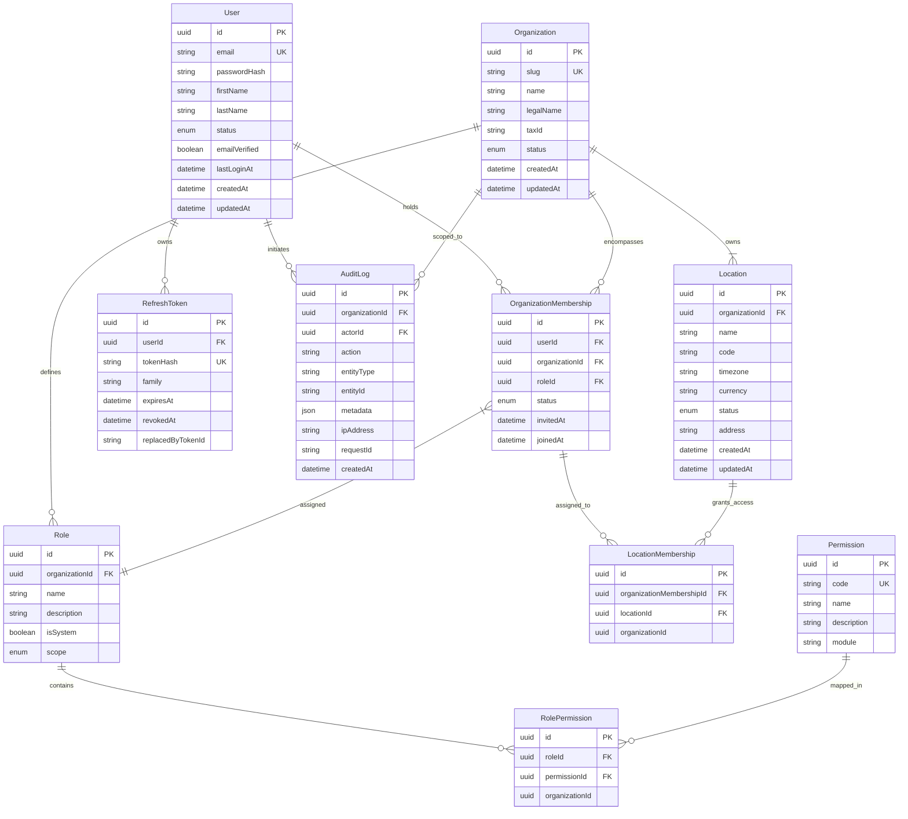

# Apollo Restaurant OS — Phase 1: Core Domain Models & Multi-Tenant Authentication Architecture

**Document Version:** 1.0.0  
**Status:** Completed & Verified  
**Date:** 2026-11-12  
**Target Milestone:** Phase 1 Architectural Baseline

---

## 1. Overview & Architectural Principles

Phase 1 establishes the foundational multi-tenant data domain and cryptographic identity infrastructure for **Apollo Restaurant OS** (AI-Native Autonomous Restaurant Operating System).

### Key Architectural Principles

1. **Decoupled Global Identity & Tenant Context**: Global user identity (`users`) is decoupled from tenant-specific memberships (`organization_memberships`). A single user account can hold memberships across multiple restaurant groups without cross-tenant pollution.
2. **Database-Level Row-Level Security (RLS)**: PostgreSQL RLS enforced with `FORCE ROW LEVEL SECURITY` on all tenant-owned entities. Non-bypassable by unprivileged application roles (`apollo_app`).
3. **Transaction-Scoped Tenant Context**: All tenant-scoped operations execute within `withTenantContext(tenantId, ...)` using PostgreSQL `set_config('app.current_tenant_id', tenantId, true)` with `is_local = true`, eliminating cross-request connection pool leakage.
4. **Zero-Trust Token Lifecycle**: Short-lived JWT access tokens (15-minute expiry) coupled with rotating refresh tokens stored as cryptographically hashed SHA-256 digests. Token family rotation tracking provides automated token replay/reuse compromise detection.
5. **Audited Security Envelope**: Every authentication event, membership transition, and privilege escalation generates an immutable, sanitized audit record with redacted secrets.

---

## 2. Entity-Relationship Architecture



---

## 3. Multi-Tenant Organization & Location Hierarchy

### 3.1. Tenant Isolation Hierarchy

- **Organization (Tenant Root)**: Represents an enterprise restaurant group, holding company, or franchisee (e.g., _Gusteau Dining Group_).
  - All tenant-owned records reference `organizationId`.
  - Uniqueness constraint: `[organizationId, code]` ensures location codes (e.g., `DT-01`, `UP-02`) are unique per organization.
- **Location (Operational Unit)**: Represents a physical dining room, kitchen, bar, or cloud kitchen unit.
  - Carries operational metadata: `timezone`, `currency`, physical `address`, and `status`.
- **Location Memberships**: Staff can be constrained to specific physical restaurant locations while head-office roles (Owner, Admin) operate organization-wide.

### 3.2. RLS Security Model Matrix

| Table                      | Scope  | RLS Enabled      | Policy Predicate                                                              |
| -------------------------- | ------ | ---------------- | ----------------------------------------------------------------------------- |
| `users`                    | Global | No               | Public / Unrestricted by tenant (Global identity)                             |
| `permissions`              | Global | No               | Public / Unrestricted by tenant (System catalog)                              |
| `refresh_tokens`           | Global | No               | Bound to user via `userId` & unique `tokenHash`                               |
| `organizations`            | Tenant | **YES (FORCED)** | `id = NULLIF(current_setting('app.current_tenant_id', true), '')`             |
| `locations`                | Tenant | **YES (FORCED)** | `organizationId = NULLIF(current_setting('app.current_tenant_id', true), '')` |
| `organization_memberships` | Tenant | **YES (FORCED)** | `organizationId = NULLIF(current_setting('app.current_tenant_id', true), '')` |
| `location_memberships`     | Tenant | **YES (FORCED)** | `organizationId = NULLIF(current_setting('app.current_tenant_id', true), '')` |
| `roles`                    | Tenant | **YES (FORCED)** | `organizationId = NULLIF(current_setting('app.current_tenant_id', true), '')` |
| `role_permissions`         | Tenant | **YES (FORCED)** | `organizationId = NULLIF(current_setting('app.current_tenant_id', true), '')` |
| `audit_logs`               | Tenant | **YES (FORCED)** | `organizationId IS NULL OR organizationId = NULLIF(...)`                      |

---

## 4. Role & Permission Matrix (RBAC)

System roles are seeded per organization upon initial onboarding:

| Permission Code    | Module       | Owner | Admin | Manager | Server | Kitchen | Viewer |
| ------------------ | ------------ | :---: | :---: | :-----: | :----: | :-----: | :----: |
| `org:manage`       | organization |   ✓   |   —   |    —    |   —    |    —    |   —    |
| `org:view`         | organization |   ✓   |   ✓   |    ✓    |   —    |    —    |   ✓    |
| `location:manage`  | location     |   ✓   |   ✓   |    ✓    |   —    |    —    |   —    |
| `location:view`    | location     |   ✓   |   ✓   |    ✓    |   —    |    —    |   ✓    |
| `user:manage`      | user         |   ✓   |   ✓   |    —    |   —    |    —    |   —    |
| `user:view`        | user         |   ✓   |   ✓   |    ✓    |   —    |    —    |   ✓    |
| `user:invite`      | user         |   ✓   |   ✓   |    ✓    |   —    |    —    |   —    |
| `role:manage`      | role         |   ✓   |   ✓   |    —    |   —    |    —    |   —    |
| `role:view`        | role         |   ✓   |   ✓   |    ✓    |   —    |    —    |   ✓    |
| `menu:manage`      | menu         |   ✓   |   ✓   |    ✓    |   —    |    —    |   —    |
| `menu:view`        | menu         |   ✓   |   ✓   |    ✓    |   ✓    |    ✓    |   ✓    |
| `order:create`     | order        |   ✓   |   ✓   |    ✓    |   ✓    |    —    |   —    |
| `order:view`       | order        |   ✓   |   ✓   |    ✓    |   ✓    |    ✓    |   ✓    |
| `order:manage`     | order        |   ✓   |   ✓   |    ✓    |   —    |    —    |   —    |
| `order:void`       | order        |   ✓   |   ✓   |    ✓    |   —    |    —    |   —    |
| `payment:process`  | payment      |   ✓   |   ✓   |    ✓    |   ✓    |    —    |   —    |
| `payment:refund`   | payment      |   ✓   |   ✓   |    ✓    |   —    |    —    |   —    |
| `payment:view`     | payment      |   ✓   |   ✓   |    ✓    |   ✓    |    —    |   ✓    |
| `inventory:manage` | inventory    |   ✓   |   ✓   |    ✓    |   —    |    —    |   —    |
| `inventory:view`   | inventory    |   ✓   |   ✓   |    ✓    |   —    |    ✓    |   ✓    |
| `report:view`      | report       |   ✓   |   ✓   |    ✓    |   —    |    —    |   ✓    |
| `report:export`    | report       |   ✓   |   ✓   |    ✓    |   —    |    —    |   —    |
| `settings:manage`  | settings     |   ✓   |   —   |    —    |   —    |    —    |   —    |

---

## 5. Authentication & Token Lifecycle

```mermaid
sequenceDiagram
    autonumber
    actor Client as POS / Web Client
    participant Auth as Auth API (/api/v1/auth)
    participant Redis as Redis Cache
    participant DB as PostgreSQL 16 (RLS)

    Note over Client,Auth: 1. Registration & Login
    Client->>Auth: POST /auth/login { email, password }
    Auth->>DB: SELECT * FROM users WHERE email = $1
    Auth->>Auth: Verify Argon2id hash
    Auth->>DB: Query memberships & roles
    Auth->>DB: INSERT INTO refresh_tokens (tokenHash, family)
    Auth-->>Client: 200 OK { user, tokens: { accessToken, refreshToken, expiresIn: 900 }, organizations }

    Note over Client,Auth: 2. Authenticated API Request
    Client->>Auth: GET /api/v1/orders (Authorization: Bearer <JWT>, X-Organization-Id: <orgId>)
    Auth->>Auth: Verify JWT signature & expiration
    Auth->>DB: Verify membership in orgId
    Auth->>DB: BEGIN; SELECT set_config('app.current_tenant_id', orgId, true);
    Auth->>DB: SELECT * FROM orders; -- RLS enforced
    Auth->>DB: COMMIT;
    Auth-->>Client: 200 OK { orders }

    Note over Client,Auth: 3. Token Rotation (Every 15 min)
    Client->>Auth: POST /auth/refresh { refreshToken }
    Auth->>DB: SELECT * FROM refresh_tokens WHERE tokenHash = SHA256(rawToken)
    alt Token was already revoked (Reuse Compromise)
        Auth->>DB: UPDATE refresh_tokens SET revokedAt = NOW() WHERE family = $family
        Auth-->>Client: 401 Unauthorized (Compromise Detected)
    else Token valid & active
        Auth->>DB: UPDATE current SET revokedAt = NOW(), replacedByTokenId = new.id
        Auth->>DB: INSERT INTO refresh_tokens (new token, same family)
        Auth-->>Client: 200 OK { new accessToken, new refreshToken }
    end
```

---

## 6. Authorization Architecture & Middleware

Three composable Express middleware enforce server-side security:

1. **`authenticate`**:
   - Validates Bearer access JWT with `jwt.verify(token, env.JWT_SECRET)`.
   - Rejects expired, tampered, or non-access tokens.
   - Populates `req.user`.

2. **`requireOrganizationMembership`**:
   - Resolves target organization from route params (`:organizationId`), headers (`X-Organization-Id`), or query string.
   - Verifies that `req.user` holds an `ACTIVE` membership in that tenant.
   - Prevents cross-tenant impersonation (e.g., swapping organizationId in requests).
   - Injects `req.organizationId` and `req.currentMembership`.

3. **`requirePermission(...permissions)`**:
   - Ensures caller has the requisite operational capabilities (e.g. `order:void`, `menu:manage`).
   - Automatically grants access to `Owner` roles.

4. **`requireLocationAccess`**:
   - Enforces location-level scoping for non-admin restaurant staff.

---

## 7. API Endpoint Specifications

All endpoints are documented in Swagger/OpenAPI at `/api-docs`:

- `POST /api/v1/auth/register`: Onboards an enterprise organization, root Owner account, and seeded roles.
- `POST /api/v1/auth/login`: Authenticates user credentials with Argon2id; returns JWT access & refresh tokens.
- `POST /api/v1/auth/refresh`: Rotates refresh tokens with replay detection.
- `POST /api/v1/auth/logout`: Revokes the current session's refresh token.
- `POST /api/v1/auth/logout-all`: Revokes all active refresh tokens for the user across all devices.
- `GET /api/v1/auth/me`: Retrieves current authenticated user profile, organization memberships, and permission scopes.

---

## 8. Database Migrations

- **Phase 0.5 Baseline**: `20261112200000_init/migration.sql`
- **Phase 1 Domain & Auth**: `20261113000000_phase1_domain_auth/migration.sql`
  - Created 5 enums (`OrgStatus`, `LocationStatus`, `UserStatus`, `MembershipStatus`, `RoleScope`).
  - Added columns to `organizations` and `locations`.
  - Created tables: `users`, `roles`, `permissions`, `role_permissions`, `organization_memberships`, `location_memberships`, `refresh_tokens`, `audit_logs`.
  - Added `ENABLE/FORCE ROW LEVEL SECURITY` and multi-tenant policies for all tenant entities.

---

## 9. Verification & Test Summary

```
✓ Vitest Backend API Tests:       30/30 PASSED (100%)
  • RLS Database Engine Tests:     10/10 PASSED (Real PG 16.4 engine via PGlite)
  • Auth Endpoint & RBAC Tests:   14/14 PASSED
  • Rate Limiting Tests:           4/4 PASSED
  • Health Route Tests:            2/2 PASSED
✓ Vitest Frontend Web Tests:        3/3 PASSED (100%)
  • App Component & Layouts:       1/1 PASSED
  • LoginPage & Form Validation:   2/2 PASSED
✓ Pytest AI Agent Tests:            4/4 PASSED (100%)
✓ Static Analysis & Code Quality:
  • pnpm run build:                100% Success
  • pnpm run typecheck:            0 errors
  • pnpm run lint:                 0 errors, 0 warnings
```
