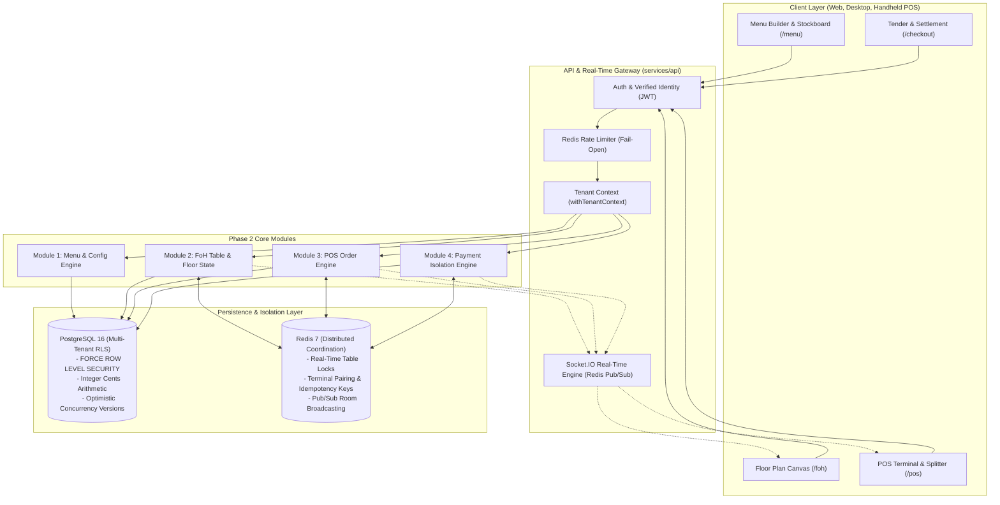
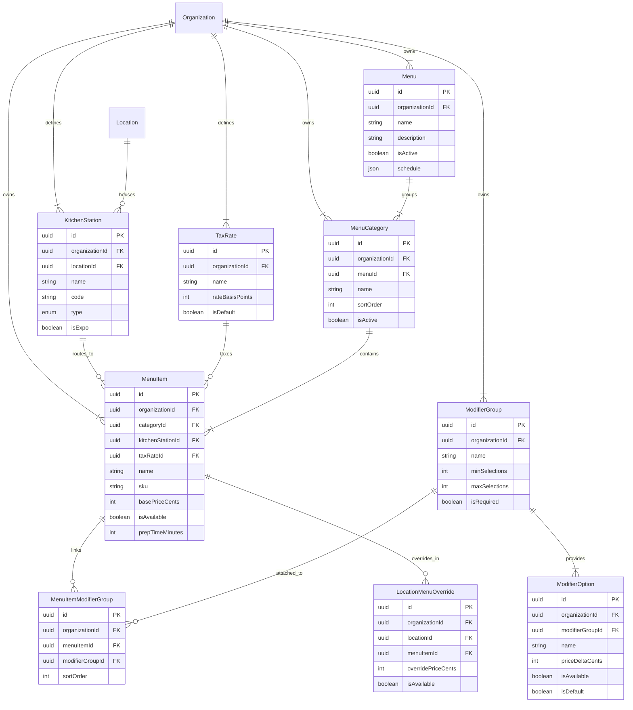
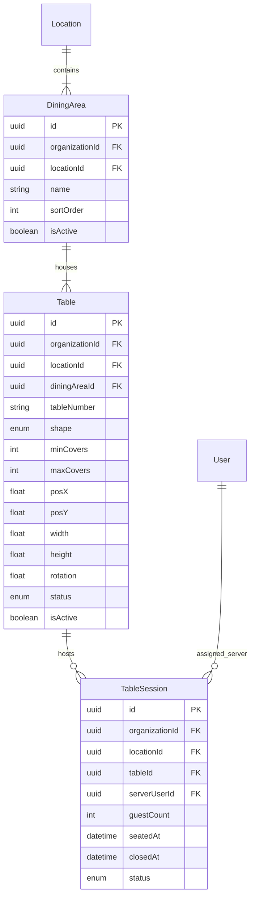
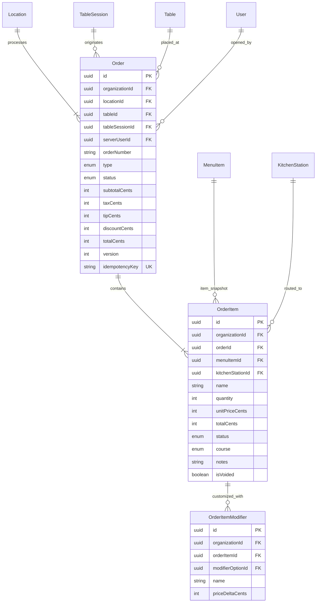
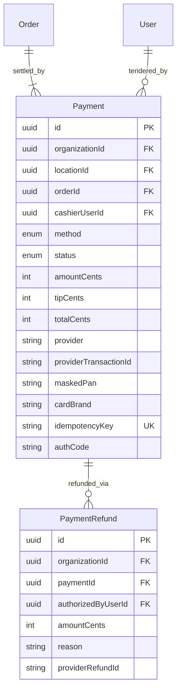
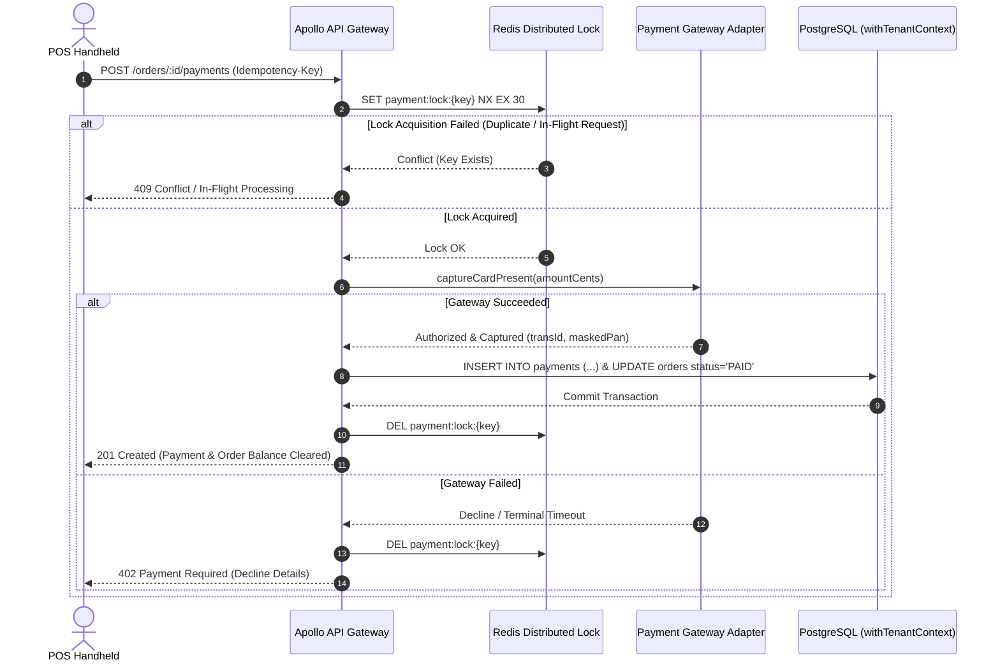
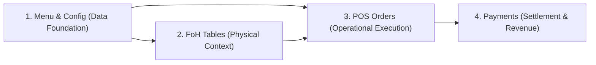

# Apollo Restaurant OS — Phase 2 Implementation Plan

## Core Operations: Menu, Floor Plan, POS & Payment Isolation

**Document Version:** 1.0.0  
**Status:** Approved Architectural Blueprint  
**Target Milestone:** Phase 2 Operational Core  
**Author:** Principal Software Architect & Application Security Engineer

---

## 1. Executive Summary & Architectural Overview

Phase 1 established the multi-tenant identity hierarchy, PostgreSQL Row-Level Security (RLS) policies, Argon2id authentication, RBAC primitives, and a resilient Redis rate-limiter lifecycle.

Phase 2 builds the operational restaurant engine upon this foundation. It covers the four essential business modules that transition Apollo Restaurant OS from an identity platform into a fully functional point-of-sale and restaurant management system:

1. **Restaurant Configuration & Menu Management**: Organization & location settings, kitchen stations, tax policies, and the complete hierarchical menu catalog (menus, categories, items, modifier groups, and rules).
2. **FoH Floor Plan & Table Management**: Dynamic visual floor plans, geometric table canvases, seating state machines, and real-time server section assignments.
3. **POS Order Management**: High-throughput order lifecycle, table-side ordering, modifier selections, split checks, kitchen firing, void auditing, and optimistic concurrency.
4. **Payment Isolation Foundation**: PCI-DSS out-of-scope tokenized payment gateway abstraction, multi-tender settlement, tip adjustment workflows, and strict idempotency enforcement.

### Phase 2 Architecture & Data Flow



---

## 2. Global Design & Security Invariants

All Phase 2 modules strictly inherit the Phase 0.5 and Phase 1 security standards:

1. **Uncompromised Tenant Isolation**:
   - Every tenant-owned table contains an `organizationId` foreign key referencing `organizations(id)` and a `locationId` foreign key referencing `locations(id)`.
   - All tenant queries execute within `withTenantContext(organizationId, tx => ...)`.
   - Every table is protected by `FORCE ROW LEVEL SECURITY` with `current_setting('app.current_tenant_id', true)`.
2. **Financial Precision (Zero Floating-Point Drift)**:
   - All monetary values (`basePrice`, `priceDelta`, `subtotal`, `tax`, `tip`, `discount`, `total`) are stored as 64-bit integer cents (`BigInt` or `Int` in Prisma, `cents: number` in TypeScript).
   - Floating-point `Float` types are prohibited for currency.
3. **Strict Idempotency**:
   - All mutating order transitions and payment transactions require a unique `Idempotency-Key` header (UUIDv4). Keys are checked against Redis with an atomic TTL lock before database persistence.
4. **Optimistic Concurrency Control**:
   - High-concurrency entities (`Order`, `TableSession`) incorporate a monotonically increasing `version: Int @default(1)` column to prevent race conditions during simultaneous table-side edits.
5. **PCI-DSS Scope Isolation**:
   - Zero storage or transit of Primary Account Numbers (PAN), CVVs, or PINs. Only provider-tokenized representations and masked card metadata (`*4242`) exist in the Apollo database.

---

## 3. Module 1: Restaurant Configuration & Menu Management

### 3.1 Overview

The Menu Management module powers the product hierarchy, kitchen routing definitions, modifier dependency graph, and multi-location availability overrides.

### 3.2 Database Models & Prisma Schema Changes



#### Prisma Schema Specification

```prisma
enum StationType {
  KITCHEN
  BAR
  GRILL
  SALAD
  PIZZA
  EXPO
  DESSERT
}

model KitchenStation {
  id             String      @id @default(uuid())
  organizationId String
  locationId     String
  name           String
  code           String
  type           StationType @default(KITCHEN)
  isExpo         Boolean     @default(false)
  createdAt      DateTime    @default(now())
  updatedAt      DateTime    @updatedAt

  organization Organization @relation(fields: [organizationId], references: [id], onDelete: Cascade)
  location     Location     @relation(fields: [locationId], references: [id], onDelete: Cascade)
  menuItems    MenuItem[]

  @@unique([locationId, code])
  @@index([organizationId])
  @@map("kitchen_stations")
}

model TaxRate {
  id              String   @id @default(uuid())
  organizationId  String
  name            String
  rateBasisPoints Int      // e.g., 825 = 8.25%
  isDefault       Boolean  @default(false)
  createdAt       DateTime @default(now())
  updatedAt       DateTime @updatedAt

  organization Organization @relation(fields: [organizationId], references: [id], onDelete: Cascade)
  menuItems    MenuItem[]

  @@index([organizationId])
  @@map("tax_rates")
}

model Menu {
  id             String   @id @default(uuid())
  organizationId String
  name           String
  description    String?
  isActive       Boolean  @default(true)
  schedule       Json?    // e.g. {"days": [1,2,3,4,5], "start": "11:00", "end": "15:00"}
  createdAt      DateTime @default(now())
  updatedAt      DateTime @updatedAt

  organization Organization   @relation(fields: [organizationId], references: [id], onDelete: Cascade)
  categories   MenuCategory[]

  @@index([organizationId])
  @@map("menus")
}

model MenuCategory {
  id             String   @id @default(uuid())
  organizationId String
  menuId         String
  name           String
  description    String?
  sortOrder      Int      @default(0)
  isActive       Boolean  @default(true)
  createdAt      DateTime @default(now())
  updatedAt      DateTime @updatedAt

  organization Organization @relation(fields: [organizationId], references: [id], onDelete: Cascade)
  menu         Menu         @relation(fields: [menuId], references: [id], onDelete: Cascade)
  items        MenuItem[]

  @@index([organizationId])
  @@index([menuId, sortOrder])
  @@map("menu_categories")
}

model MenuItem {
  id               String   @id @default(uuid())
  organizationId   String
  categoryId       String
  kitchenStationId String?
  taxRateId        String?
  name             String
  description      String?
  sku              String?
  basePriceCents   Int
  isAvailable      Boolean  @default(true) // 86 status
  prepTimeMinutes  Int      @default(15)
  calories         Int?
  allergens        String[] @default([])
  createdAt        DateTime @default(now())
  updatedAt        DateTime @updatedAt

  organization   Organization            @relation(fields: [organizationId], references: [id], onDelete: Cascade)
  category       MenuCategory            @relation(fields: [categoryId], references: [id], onDelete: Cascade)
  kitchenStation KitchenStation?         @relation(fields: [kitchenStationId], references: [id], onDelete: SetNull)
  taxRate        TaxRate?                @relation(fields: [taxRateId], references: [id], onDelete: SetNull)
  modifierGroups MenuItemModifierGroup[]
  overrides      LocationMenuOverride[]

  @@index([organizationId])
  @@index([categoryId])
  @@map("menu_items")
}

model ModifierGroup {
  id             String   @id @default(uuid())
  organizationId String
  name           String
  minSelections  Int      @default(0)
  maxSelections  Int      @default(1)
  isRequired     Boolean  @default(false)
  createdAt      DateTime @default(now())
  updatedAt      DateTime @updatedAt

  organization Organization            @relation(fields: [organizationId], references: [id], onDelete: Cascade)
  options      ModifierOption[]
  menuItems    MenuItemModifierGroup[]

  @@index([organizationId])
  @@map("modifier_groups")
}

model MenuItemModifierGroup {
  id              String @id @default(uuid())
  organizationId  String
  menuItemId      String
  modifierGroupId String
  sortOrder       Int    @default(0)

  menuItem      MenuItem      @relation(fields: [menuItemId], references: [id], onDelete: Cascade)
  modifierGroup ModifierGroup @relation(fields: [modifierGroupId], references: [id], onDelete: Cascade)

  @@unique([menuItemId, modifierGroupId])
  @@index([organizationId])
  @@map("menu_item_modifier_groups")
}

model ModifierOption {
  id              String   @id @default(uuid())
  organizationId  String
  modifierGroupId String
  name            String
  priceDeltaCents Int      @default(0)
  isAvailable     Boolean  @default(true)
  isDefault       Boolean  @default(false)
  createdAt       DateTime @default(now())
  updatedAt       DateTime @updatedAt

  modifierGroup ModifierGroup @relation(fields: [modifierGroupId], references: [id], onDelete: Cascade)

  @@index([organizationId])
  @@index([modifierGroupId])
  @@map("modifier_options")
}

model LocationMenuOverride {
  id                 String   @id @default(uuid())
  organizationId     String
  locationId         String
  menuItemId         String
  overridePriceCents Int?
  isAvailable        Boolean? // location-specific 86
  createdAt          DateTime @default(now())
  updatedAt          DateTime @updatedAt

  location Location @relation(fields: [locationId], references: [id], onDelete: Cascade)
  menuItem MenuItem @relation(fields: [menuItemId], references: [id], onDelete: Cascade)

  @@unique([locationId, menuItemId])
  @@index([organizationId])
  @@map("location_menu_overrides")
}
```

### 3.3 REST API Endpoints

- `GET /api/v1/menus` — List menus with active categories and items.
- `POST /api/v1/menus` — Create new menu (Requires `menu:manage`).
- `GET /api/v1/menus/:id` — Get full menu tree with modifier groups.
- `PUT /api/v1/menus/:id` — Update menu metadata and active schedule.
- `POST /api/v1/menu-items` — Create menu item with station routing & tax rate.
- `PATCH /api/v1/menu-items/:id/availability` — High-speed 86 toggle (`{ isAvailable: boolean, reason?: string }`).
- `POST /api/v1/modifier-groups` — Create reusable modifier group with constraints.
- `POST /api/v1/kitchen-stations` — Define location kitchen stations (`location:manage`).

### 3.4 RBAC Matrix

| Role              | `menu:view` |    `menu:manage`     | `menu:86_toggle` |  `location:manage`   |
| :---------------- | :---------: | :------------------: | :--------------: | :------------------: |
| **Owner / Admin** |     Yes     |         Yes          |       Yes        |         Yes          |
| **Manager**       |     Yes     | Yes (Location Scope) |       Yes        | Yes (Location Scope) |
| **Server**        |     Yes     |          No          |        No        |          No          |
| **Kitchen Staff** |     Yes     |          No          |       Yes        |          No          |

### 3.5 Real-Time WebSocket Events

- Channel: `org:{orgId}:loc:{locId}:menu`
- `menu:item:86ed` — Broadcast when item goes out of stock (instant POS ticket disabling).
- `menu:item:restocked` — Broadcast when item returns to stock.
- `menu:price:updated` — Broadcast when pricing alters.

### 3.6 Frontend Pages & Components

- `/menu/builder` — Dual-pane visual catalog editor (Categories on left, item grid on right).
- `/menu/item-modal` — Deep item editor with modifier group matrix association.
- `/menu/stockboard` — High-contrast, tactile 86 toggle board for Kitchen Expo and Shift Supervisors.

---

## 4. Module 2: FoH Floor Plan & Table Management

### 4.1 Overview

The Front of House (FoH) module models physical dining layouts, visual coordinates for canvas rendering, real-time table occupancy lifecycles, and server station zone assignments.

### 4.2 Database Models & Prisma Schema Changes



#### Prisma Schema Specification

```prisma
enum TableShape {
  RECTANGLE
  ROUND
  SQUARE
  BOOTH
  BAR_STOOL
}

enum TableStatus {
  AVAILABLE
  SEATED
  ORDERED
  SERVED
  PAYMENT_PENDING
  DIRTY
  RESERVED
  BLOCKED
}

enum SessionStatus {
  ACTIVE
  COMPLETED
  TRANSFERRED
}

model DiningArea {
  id             String   @id @default(uuid())
  organizationId String
  locationId     String
  name           String   // e.g. "Main Dining Room", "Patio", "Bar"
  sortOrder      Int      @default(0)
  isActive       Boolean  @default(true)
  createdAt      DateTime @default(now())
  updatedAt      DateTime @updatedAt

  organization Organization @relation(fields: [organizationId], references: [id], onDelete: Cascade)
  location     Location     @relation(fields: [locationId], references: [id], onDelete: Cascade)
  tables       Table[]

  @@unique([locationId, name])
  @@index([organizationId])
  @@map("dining_areas")
}

model Table {
  id             String      @id @default(uuid())
  organizationId String
  locationId     String
  diningAreaId   String
  tableNumber    String
  shape          TableShape  @default(RECTANGLE)
  minCovers      Int         @default(1)
  maxCovers      Int         @default(4)
  posX           Float       @default(0) // Visual 2D coordinate
  posY           Float       @default(0)
  width          Float       @default(100)
  height         Float       @default(100)
  rotation       Float       @default(0)
  status         TableStatus @default(AVAILABLE)
  isActive       Boolean     @default(true)
  createdAt      DateTime    @default(now())
  updatedAt      DateTime    @updatedAt

  organization Organization   @relation(fields: [organizationId], references: [id], onDelete: Cascade)
  location     Location       @relation(fields: [locationId], references: [id], onDelete: Cascade)
  diningArea   DiningArea     @relation(fields: [diningAreaId], references: [id], onDelete: Cascade)
  sessions     TableSession[]
  orders       Order[]

  @@unique([locationId, tableNumber])
  @@index([organizationId])
  @@index([locationId, status])
  @@map("tables")
}

model TableSession {
  id             String        @id @default(uuid())
  organizationId String
  locationId     String
  tableId        String
  serverUserId   String?
  guestCount     Int           @default(2)
  seatedAt       DateTime      @default(now())
  closedAt       DateTime?
  status         SessionStatus @default(ACTIVE)
  createdAt      DateTime      @default(now())
  updatedAt      DateTime      @updatedAt

  organization Organization @relation(fields: [organizationId], references: [id], onDelete: Cascade)
  location     Location     @relation(fields: [locationId], references: [id], onDelete: Cascade)
  table        Table        @relation(fields: [tableId], references: [id], onDelete: Cascade)
  server       User?        @relation(fields: [serverUserId], references: [id], onDelete: SetNull)
  orders       Order[]

  @@index([organizationId])
  @@index([locationId, status])
  @@map("table_sessions")
}
```

### 4.3 REST API Endpoints

- `GET /api/v1/locations/:locId/floor-plan` — Get all areas, tables, active sessions & server assignments.
- `POST /api/v1/dining-areas` — Create a new dining room section.
- `PUT /api/v1/locations/:locId/tables/layout` — Bulk coordinate and dimension save for visual floor designer.
- `POST /api/v1/tables/:id/seat` — Seat table (Creates `TableSession`, sets status to `SEATED`).
- `PATCH /api/v1/tables/:id/status` — Manual state transition (`AVAILABLE` -> `SEATED` -> `DIRTY` -> `AVAILABLE`).
- `POST /api/v1/tables/:id/transfer` — Transfer table or active session to another server or table.

### 4.4 Real-Time WebSocket Events

- Channel: `org:{orgId}:loc:{locId}:tables`
- `table:status_changed` — Live update on color/state badge across all host stands and server handhelds.
- `table:seated` — Party seated with guest count and server claim.
- `table:cleared` — Table bused and reset to `AVAILABLE`.

### 4.5 Frontend Pages & Components

- `/foh/floor-plan` — SVG/Canvas interactive dining room. Color-coded tables:
  - Green: `AVAILABLE`
  - Blue: `SEATED`
  - Yellow: `ORDERED`
  - Purple: `PAYMENT_PENDING`
  - Gray: `DIRTY`
- `/foh/floor-designer` — Admin grid canvas with drag, resize, rotate, and snap-to-grid tools.
- `/foh/table-modal` — Quick action modal for seating parties, assigning servers, or jumping to active POS ticket.

---

## 5. Module 3: POS Order Management

### 5.1 Overview

The POS Order Management module handles high-speed ticket entry, modifier resolution, course pacing, kitchen ticket firing, void tracking, and multi-ticket splitting.

### 5.2 Database Models & Prisma Schema Changes



#### Prisma Schema Specification

```prisma
enum OrderType {
  DINE_IN
  TAKEOUT
  DELIVERY
  BAR_TAB
}

enum OrderStatus {
  DRAFT
  PENDING
  IN_PREPARATION
  READY
  SERVED
  PAID
  COMPLETED
  VOIDED
}

enum OrderItemStatus {
  HELD
  SENT_TO_KITCHEN
  PREPARING
  READY
  SERVED
  VOIDED
}

enum Course {
  DRINKS
  APPETIZER
  ENTREE
  DESSERT
}

model Order {
  id               String      @id @default(uuid())
  organizationId   String
  locationId       String
  tableId          String?
  tableSessionId   String?
  serverUserId     String
  orderNumber      String      // Sequential human-readable, e.g. "ORD-0142"
  type             OrderType   @default(DINE_IN)
  status           OrderStatus @default(DRAFT)
  subtotalCents    Int         @default(0)
  taxCents         Int         @default(0)
  tipCents         Int         @default(0)
  discountCents    Int         @default(0)
  totalCents       Int         @default(0)
  version          Int         @default(1) // Optimistic concurrency lock
  idempotencyKey   String?     @unique
  notes            String?
  closedAt         DateTime?
  createdAt        DateTime    @default(now())
  updatedAt        DateTime    @updatedAt

  organization Organization   @relation(fields: [organizationId], references: [id], onDelete: Cascade)
  location     Location       @relation(fields: [locationId], references: [id], onDelete: Cascade)
  table        Table?         @relation(fields: [tableId], references: [id], onDelete: SetNull)
  tableSession TableSession?  @relation(fields: [tableSessionId], references: [id], onDelete: SetNull)
  server       User           @relation(fields: [serverUserId], references: [id], onDelete: Restrict)
  items        OrderItem[]
  payments     Payment[]

  @@index([organizationId])
  @@index([locationId, status])
  @@index([tableSessionId])
  @@map("orders")
}

model OrderItem {
  id               String          @id @default(uuid())
  organizationId   String
  orderId          String
  menuItemId       String
  kitchenStationId String?
  name             String          // Snapshot name at time of sale
  quantity         Int             @default(1)
  unitPriceCents   Int
  totalCents       Int
  status           OrderItemStatus @default(HELD)
  course           Course          @default(ENTREE)
  notes            String?
  isVoided         Boolean         @default(false)
  voidReason       String?
  voidedByUserId   String?
  createdAt        DateTime        @default(now())
  updatedAt        DateTime        @updatedAt

  organization   Organization        @relation(fields: [organizationId], references: [id], onDelete: Cascade)
  order          Order               @relation(fields: [orderId], references: [id], onDelete: Cascade)
  menuItem       MenuItem            @relation(fields: [menuItemId], references: [id], onDelete: Restrict)
  kitchenStation KitchenStation?     @relation(fields: [kitchenStationId], references: [id], onDelete: SetNull)
  modifiers      OrderItemModifier[]

  @@index([organizationId])
  @@index([orderId])
  @@index([kitchenStationId, status])
  @@map("order_items")
}

model OrderItemModifier {
  id               String @id @default(uuid())
  organizationId   String
  orderItemId      String
  modifierOptionId String
  name             String // Snapshot option name
  priceDeltaCents  Int    @default(0)

  orderItem OrderItem @relation(fields: [orderItemId], references: [id], onDelete: Cascade)

  @@index([organizationId])
  @@index([orderItemId])
  @@map("order_item_modifiers")
}
```

### 5.3 REST API Endpoints

- `POST /api/v1/orders` — Initialize new draft order with `Idempotency-Key`.
- `GET /api/v1/orders/:id` — Full order detail with items, modifiers, and payment balance.
- `POST /api/v1/orders/:id/items` — Add items & modifiers with optimistic version match (`version: N`).
- `DELETE /api/v1/orders/:id/items/:itemId` — Remove or void item (Manager approval token required if already fired).
- `POST /api/v1/orders/:id/fire` — Fire `HELD` items to kitchen stations (changes status to `SENT_TO_KITCHEN`).
- `POST /api/v1/orders/:id/split` — Split order into multiple child tickets by seat or custom item allocation.

### 5.4 Concurrency & Concurrency Race Mitigation

Handheld devices in active dining rooms submit updates asynchronously. The API validates `version`:

```sql
UPDATE orders
SET "totalCents" = $1, "version" = "version" + 1
WHERE id = $2 AND "version" = $expectedVersion AND "organizationId" = $tenantId;
```

If 0 rows are updated, the API returns `409 Conflict`, prompting the client to pull the latest state.

---

## 6. Module 4: Payment Isolation Foundation

### 6.1 Overview

The Payment Isolation module encapsulates transaction settlement, multi-tender split tender, tip adjustments, and cash drawer management while maintaining zero exposure to raw cardholder data.

### 6.2 Database Models & Prisma Schema Changes



#### Prisma Schema Specification

```prisma
enum PaymentMethod {
  CASH
  CARD_PRESENT     // EMV Chip / Contactless Terminal
  CARD_NOT_PRESENT // Manual Keyed / Web Online
  GIFT_CARD
  HOUSE_ACCOUNT
}

enum PaymentStatus {
  PENDING
  AUTHORIZED
  CAPTURED
  FAILED
  REFUNDED
  PARTIALLY_REFUNDED
  VOIDED
}

model Payment {
  id                    String        @id @default(uuid())
  organizationId        String
  locationId            String
  orderId               String
  cashierUserId         String
  method                PaymentMethod
  status                PaymentStatus @default(PENDING)
  amountCents           Int           // Base charge
  tipCents              Int           @default(0)
  totalCents            Int           // amount + tip
  currency              String        @default("USD")
  provider              String        @default("MOCK_GATEWAY") // "STRIPE_TERMINAL", "SQUARE", "ADYEN"
  providerTransactionId String?
  terminalId            String?       // Hardware serial / reader ID
  maskedPan             String?       // e.g. "************4242"
  cardBrand             String?       // "VISA", "MASTERCARD", "AMEX"
  authCode              String?
  idempotencyKey        String        @unique
  createdAt             DateTime      @default(now())
  updatedAt             DateTime      @updatedAt

  organization Organization    @relation(fields: [organizationId], references: [id], onDelete: Cascade)
  location     Location        @relation(fields: [locationId], references: [id], onDelete: Cascade)
  order        Order           @relation(fields: [orderId], references: [id], onDelete: Restrict)
  cashier      User            @relation(fields: [cashierUserId], references: [id], onDelete: Restrict)
  refunds      PaymentRefund[]

  @@index([organizationId])
  @@index([orderId])
  @@index([locationId, createdAt])
  @@map("payments")
}

model PaymentRefund {
  id                 String   @id @default(uuid())
  organizationId     String
  paymentId          String
  authorizedByUserId String
  amountCents        Int
  reason             String
  providerRefundId   String?
  createdAt          DateTime @default(now())

  organization Organization @relation(fields: [organizationId], references: [id], onDelete: Cascade)
  payment      Payment      @relation(fields: [paymentId], references: [id], onDelete: Cascade)
  authorizedBy User         @relation(fields: [authorizedByUserId], references: [id], onDelete: Restrict)

  @@index([organizationId])
  @@index([paymentId])
  @@map("payment_refunds")
}
```

### 6.3 Payment Gateway Adapter Pattern

All external payment provider calls are routed through an isolated adapter interface:

```typescript
export interface PaymentGatewayAdapter {
  captureCardPresent(params: {
    terminalId: string;
    amountCents: number;
    idempotencyKey: string;
  }): Promise<GatewayTransactionResult>;

  adjustTip(params: {
    providerTransactionId: string;
    tipCents: number;
  }): Promise<GatewayTransactionResult>;

  refund(params: {
    providerTransactionId: string;
    amountCents: number;
    reason: string;
  }): Promise<GatewayRefundResult>;
}
```

### 6.4 Double-Charge Prevention Flow



---

## 7. Strategic Recommendation: Implementation Sequence

### **Recommended First Module: Module 1 (Restaurant Configuration & Menu Management)**



### Justification:

1. **Upstream Catalog Dependency**:
   - Neither POS ordering nor table checks can be created without structured items, pricing, tax rates, and kitchen station routing.
   - Menu Management provides the baseline catalog required by both human servers and autonomous BoH agents.
2. **Deterministic Pricing Engine**:
   - Menu pricing and modifier rules must exist and be validated before order total calculations and financial ledgers can operate accurately.
3. **Execution Roadmap**:
   - **Step 1**: Implement **Module 1 (Menu & Config)** — build Prisma migration, RLS policies, seed scripts, validation schemas, and web catalog management.
   - **Step 2**: Implement **Module 2 (FoH & Tables)** — build visual layout, seating engine, and live table status synchronization.
   - **Step 3**: Implement **Module 3 (POS Orders)** — bind menu items to seated tables, implement ticket dispatch, kitchen routing, and bill splitting.
   - **Step 4**: Implement **Module 4 (Payment Isolation)** — integrate tokenized tender capture, tip adjustment, and final order settlement.

---

## 8. Verification & Test Strategy

| Test Suite                            | Scope               | Target Invariants                                                                                                                |
| :------------------------------------ | :------------------ | :------------------------------------------------------------------------------------------------------------------------------- |
| **RLS Multi-Tenant Verification**     | Postgres Unit Tests | Verify Tenant B cannot read or mutate Menu, Table, Order, or Payment records of Tenant A.                                        |
| **Calculation Precision Tests**       | Domain Unit Tests   | Verify tax calculation, item addition, and modifier delta summation strictly using integer cents with zero floating-point error. |
| **Optimistic Concurrency Tests**      | Integration Tests   | Verify simultaneous order edits with outdated `version` numbers receive `409 Conflict`.                                          |
| **Idempotency & Double Charge Tests** | Integration Tests   | Verify resubmitting the identical `Idempotency-Key` does not duplicate charges or order items.                                   |
| **Real-Time Broadcast Tests**         | WebSocket Tests     | Verify table status and 86 stock updates reach only terminals joined to the corresponding `locationId` room.                     |
