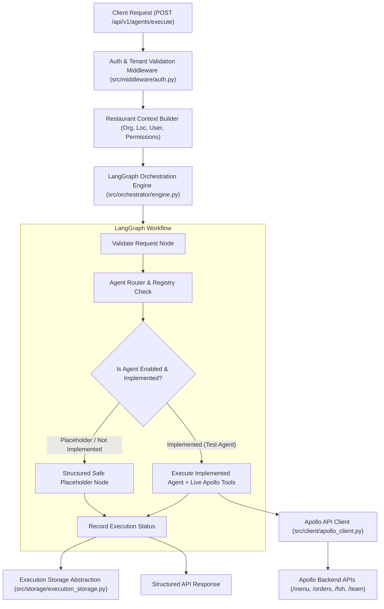

# Apollo Restaurant OS — AI Agent Orchestration Service (`services/agents`)

The AI Agent Orchestration Service provides the centralized intelligence and coordination layer for Apollo Restaurant OS. Built with Python 3.12, FastAPI, and LangGraph, it orchestrates domain-specific restaurant agents while enforcing multi-tenant isolation, caller permission validation, and authenticated live tool integrations.

---

## 1. Orchestrator Architecture

The service coordinates task planning and execution via a state-graph workflow:



### Core Components

1. **Restaurant Context (`src/context/restaurant_context.py`)**: Immutable, tenant-aware context containing `organization_id`, `location_id`, `user_id`, `user_role`, and `permissions`.
2. **Agent Registry (`src/registry/agent_registry.py`)**: Extensible registry defining registered agents, operational domains, capabilities, and implementation statuses.
3. **Tool Registry (`src/registry/tool_registry.py`)**: Permission-guarded registry for read-only restaurant tools connected to live Apollo backend endpoints.
4. **Apollo API Client (`src/client/apollo_client.py`)**: Dedicated service-to-service HTTP client managing short-lived service tokens, configurable timeouts, error status mapping, and tenant header forwarding.
5. **Execution Storage Abstraction (`src/storage/execution_storage.py`)**: Decouples lifecycle recording from storage engines. Uses an in-memory thread-safe implementation with restart limitations documented, ready to swap with PostgreSQL/Redis.
6. **LLM Provider Abstraction (`src/llm/provider.py`)**: Unified interface for Ollama, OpenAI, and Gemini with controlled fallback via `LLMUnavailableError`.
7. **Authentication & Tenant Middleware (`src/middleware/auth.py`)**: Uses the exact HS256 signing secret and validation rules of the Apollo API backend, verifying active organization membership and location access before allowing orchestration.

---

## 2. Live Tool Integrations & Backend Endpoints

The five read-only agent tools are integrated with actual Apollo Restaurant OS backend APIs:

| Tool Name                 | Backend Endpoint                                             | Required Permission                    | Description & Live Data Returned                                                      |
| ------------------------- | ------------------------------------------------------------ | -------------------------------------- | ------------------------------------------------------------------------------------- |
| `fetch_menu`              | `GET /api/v1/menu/items`, `GET /api/v1/menu/modifier-groups` | `menu:view` (or `menu:read`)           | Real menu items, category links, base prices in cents, and modifier groups.           |
| `fetch_active_orders`     | `GET /api/v1/orders/kitchen/active`                          | `order:view` (or `orders:read`)        | Live active kitchen tickets (`SUBMITTED`, `IN_PREPARATION`, `READY`) with line items. |
| `fetch_floor_status`      | `GET /api/v1/foh/locations/:locationId/floor-plan`           | `table:view` (or `floor:read`)         | Dining areas, tables, active sessions, and occupancy metrics.                         |
| `fetch_staff_summary`     | `GET /api/v1/team`                                           | `user:view` (or `staff:read`)          | Active organization staff members, roles, and location assignments.                   |
| `fetch_inventory_summary` | _N/A (Module Not Implemented)_                               | `inventory:view` (or `inventory:read`) | Controlled `NOT_IMPLEMENTED` response without fabricating data.                       |

### Handling Missing Modules (Inventory)

Apollo Restaurant OS does not currently include an Inventory module in `services/api` or Prisma schema. When `fetch_inventory_summary` is called:

- It returns `status: "NOT_IMPLEMENTED"` with a clear message and `data: None`.
- It **never** fabricates fake ingredient depletion rates or stock records.

---

## 3. Service-to-Service Authentication & Security

1. **Dedicated Service Token**:
   - The agent service generates a short-lived (5-minute) JWT signed with `settings.JWT_SECRET`.
   - Claims preserve the authenticated user's identity: `sub: context.user_id`, `type: "access"`, `client: "apollo-agents-service"`.
   - The signing secret is never exposed to LLMs, prompts, or frontend clients.
2. **Tenant Scoping & Forwarding**:
   - Every backend request explicitly sets `x-organization-id` and `x-location-id` matching the verified `RestaurantContext`.
3. **Fail-Closed Verification**:
   - Caller permissions are validated against `context.permissions` prior to dispatching HTTP requests.
   - If the backend returns 401 or 403, execution halts immediately without fallback.
4. **Error Mapping Without Silent Fallbacks**:
   - Connection failure / unreachable: `ApolloBackendUnavailableError` (503)
   - Request timeout: `ApolloBackendTimeoutError` (504)
   - Authentication rejected: `ApolloBackendAuthError` (401)
   - Access denied: `ApolloBackendForbiddenError` (403)
   - Resource not found: `ApolloBackendNotFoundError` (404)
   - Invalid JSON: `ApolloBackendResponseError` (502)

---

## 4. API Endpoints

All endpoints are mounted under both `/api/v1/agents` and `/agents`:

| Method | Endpoint                         | Description                                                     | Auth Required       |
| ------ | -------------------------------- | --------------------------------------------------------------- | ------------------- |
| `GET`  | `/api/v1/agents`                 | List registered agents, categories, and implementation statuses | No                  |
| `GET`  | `/api/v1/agents/health`          | Health check and LLM provider configuration status              | No                  |
| `POST` | `/api/v1/agents/execute`         | Submit a task for orchestration                                 | Bearer JWT + Tenant |
| `GET`  | `/api/v1/agents/executions/{id}` | Query execution status and output by ID                         | Bearer JWT + Tenant |

---

## 5. Verification Suite

Run all verification tests using pytest:

```powershell
services/agents/.venv/Scripts/python -m pytest services/agents/tests
```

Test coverage:

- `tests/test_live_tools.py`: 13 tests verifying live tool integrations, mocked transports, timeouts, permissions, and error mappings.
- `tests/test_orchestrator.py`: 14 tests verifying LangGraph execution, registry routing, tenant isolation, and lifecycle tracking.
- `tests/test_agents_base.py` & `tests/test_health.py`: 4 tests for base state graph and system health probes.
